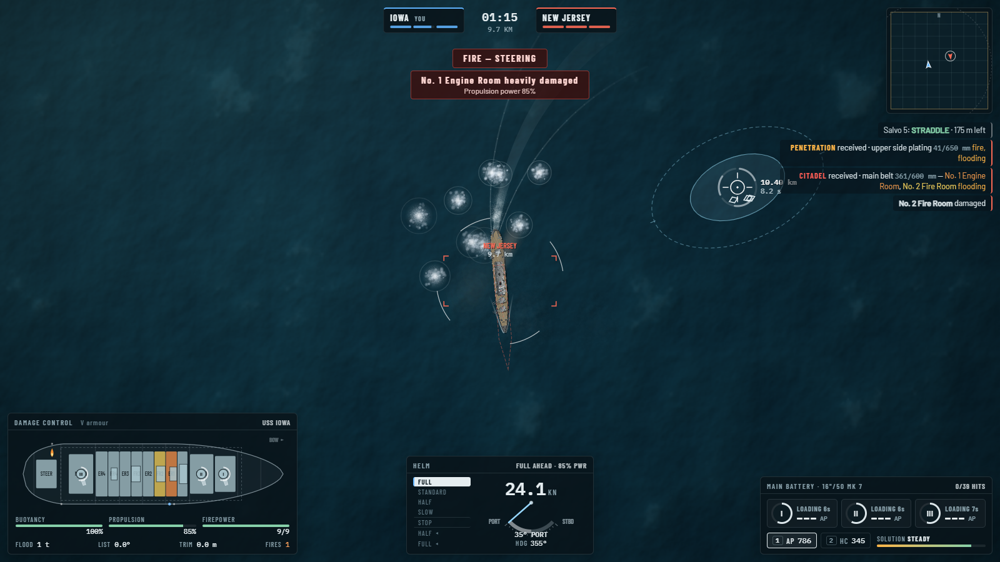

# RIPTIDE — 2D WWII battleship combat prototype

A top-down naval combat game: one Iowa-class battleship against another, with a
semi-realistic shell/armour/compartment simulation underneath arcade controls.



## Running it

| | |
|---|---|
| **Just play** | open `dist/index.html` in Chrome / Edge / Firefox (single self-contained file, works offline from disk) |
| **Develop** | `npm install` then `npm run dev` → http://localhost:5173 |
| **Build** | `npm run build` → `dist/index.html` |

## Controls

| Input | Action |
|---|---|
| `W` / `S` | Engine telegraph up / down (Full Astern … Stop … Full Ahead) |
| `A` / `D` (hold) | Rudder to port / starboard; released, it returns amidships |
| Mouse | Requested fall-of-shot point |
| `LMB` | Fire every turret that is loaded and on bearing (hold to ripple as they come ready) |
| `1` / `2` | Load AP / HC for the next reload |
| Wheel | Zoom from close tactical view to the whole battle area |
| `MMB` | On a ship: lock camera on it · on open water: back to your ship |
| `V` | Damage-control diagram ↔ armour scheme (hover the diagram for module details) |
| `Tab` | Fleet battles: take command of the next ship of your side |
| `H` · `M` · `Esc` | Controls hint · mute · pause |

## What is simulated

**Ship.** USS *Iowa* (BB-61) as built in 1943: 270 m, 57,540 t, 32.5 kn, nine 16"/50 Mk 7 in
three triple turrets, 307 mm belt inclined 19°, 152 mm armoured deck, 439 mm barbettes and
conning tower, 343 mm steering-gear box. The internal layout follows the real arrangement:
three magazines under their turrets, four fire rooms alternating with four engine rooms,
steering gear aft, two Mk 38 directors, conning tower, two funnels, ten watertight sections.
The art is generated from the same data the simulation uses, so what you see is what gets hit.

**Ballistics.** Striking velocity, angle of fall and penetration follow the shape of the real
Mk 8 AP curves. Close in, shells fly flat and hit the belt; at long range they plunge onto the
deck, which produces a genuine immune zone. Time of flight is compressed ~2× for pace.
Dispersion is a 2D normal distribution (longer in range than in line) that grows with range,
own-ship yaw, swinging the point of aim, director damage and list. The two ellipses drawn at
the cursor are the analytic 50 % and 90 % contours of that distribution.

**Armour.** Each shell is traced in 3D through the ship: superstructure blocks, turrets
(face/side/rear/roof/barbette chosen by geometry), upper side, belt, lower belt, weather deck,
then the armoured deck inside the citadel. Obliquity combines fall angle, belt incline and the
hull's curvature; AP caps normalise; high obliquity ricochets; thin plates are overmatched.

**Fuzing & effect.** AP has a 0.033 s delay fuze that only arms on enough plate — so thin
superstructure is overpenetrated harmlessly, while a belt penetration bursts metres inside,
damaging modules in a blast radius plus a forward splinter cone. Magazines sit low in the hull,
so only diving shells or plunging fire burst *inside* them. HC bursts on contact: weak against
armour, good at wrecking directors/bridge and starting fires.

**Consequences.**
- Fire rooms / engine rooms → available power → speed (∝ ∛power). Wrecked funnels reduce draught.
- Steering gear damaged → slow rudder; destroyed → rudder **jams** where it is.
- Directors → dispersion. Bridge → helm orders delayed (conning from aft).
- Turrets lose guns as they are damaged; non-penetrating hits can jam training.
- Holes below the (current) waterline flood their section through an orifice-flow model;
  pumps fight it; water crosses slowly between sides. The ship settles, trims and lists — which
  puts more holes under. Flooded machinery/magazine spaces stop working.
- Fires scorch nearby modules and spread; a fire near a magazine forces damage control to
  flood it (that turret can no longer reload).
- Magazine detonations are possible but rare.
- A ship is **out of action** when sunk, blown up, her main battery is silenced, or she is
  crippled (little firepower left plus heavy flooding/loss of power). Battles are capped at
  25 minutes; at the limit the side with more fighting strength holds the field.

**Feedback.** Every hit on or by you floats a verdict at the impact point (CITADEL /
PENETRATION / OVERPENETRATION / RICOCHET / NO PENETRATION / BELOW WATERLINE / HE HIT) with the
plate, obliquity and *effective armour vs. penetration*, and the log on the right names the
compartments it wrecked. After each of your salvos lands, a spotting report says whether it was
over, short or a straddle and by how much. Hover the damage-control diagram for any module's
state, role and protection.

**AI.** Two layers, built for fleets: a `TeamCommander` per side (target assignment /
concentration of fire, doctrine — press, hold or open the range — from relative strength) and a
`CaptainAI` per ship (keeps the enemy ~50° off the bow so all turrets bear while the belt is
angled, manages range, zig-zags and "chases salvos" after near misses, avoids collisions and
the map edge). Gunnery is not omniscient: the captain tracks the target with a noisy
rangefinder/plot filter, leads it by time of flight, and walks salvos on by spotting the fall of
shot (over/short, left/right) — classic bracketing. Difficulty changes ranging error, correction
gain and track noise.

## Architecture (built for more ships & multiplayer)

```
src/
  sim/        pure simulation — no DOM. World, Ship, damage model, ballistics, class data
  ai/         TeamCommander + CaptainAI (produce ShipCommands like any other controller)
  render/     WebGL water + 2D canvas world renderer, procedural ship art, particles, camera
  ui/         HUD (DOM + canvas gauges), damage-control diagram, menus/lobby
  audio/      fully procedural WebAudio sound
  game.ts     glue: input → commands, sim → events → presentation
```

- Every ship is driven only through a `ShipCommand` (`telegraph`, `rudder`, `aim`, `fire`, `ammo`).
  The local player, the AI, or later a network peer all produce the same structure; the sim
  never reads input devices.
- A battle is described by a `BattleConfig` (`ships: [{classId, team, x, y, heading, controller}]`).
  The **Battle Setup** screen is a working lobby prototype: drag ships on the map, set course,
  assign teams, choose who is player-controlled; everything else goes to the AI. Presets for
  2v2, 3v3 and 1v2 are included.
- The sim uses a seeded RNG and emits events (`fire`, `splash`, `hit`, `module`, …) consumed by
  renderer/HUD/audio, so a server-authoritative or lockstep model can be added by moving `World`
  server-side and streaming events/snapshots. (For lockstep, switch the sub-stepped variable
  `dt` in `game.ts` to a fixed tick.)
- New ship types are data: add a `ShipClass` in `sim/shipClass.ts` (hull curve, zones, modules,
  turrets, sections, structures); the art builder and the damage diagram adapt automatically.

## Tools

`tools/` holds the headless test harnesses used during development:
`npx tsx tools/why.ts 12` (AI-vs-AI battles, how they ended), `tools/pentest.ts` (statistical
armour probe by range/angle), `tools/tracks.ts` (plots AI manoeuvres), and Playwright scripts
(`node tools/shot.mjs <url> <script>`) that drive the game in a background headless Chrome.
